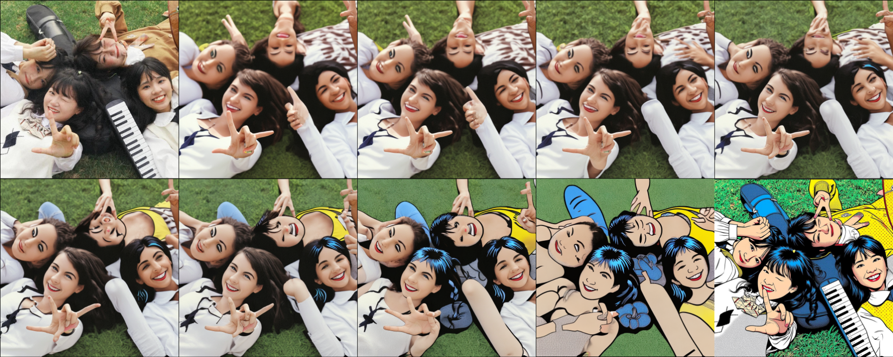
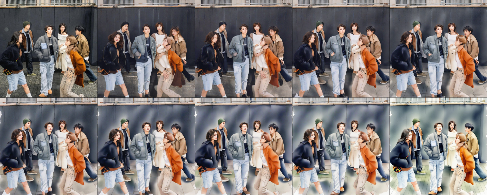
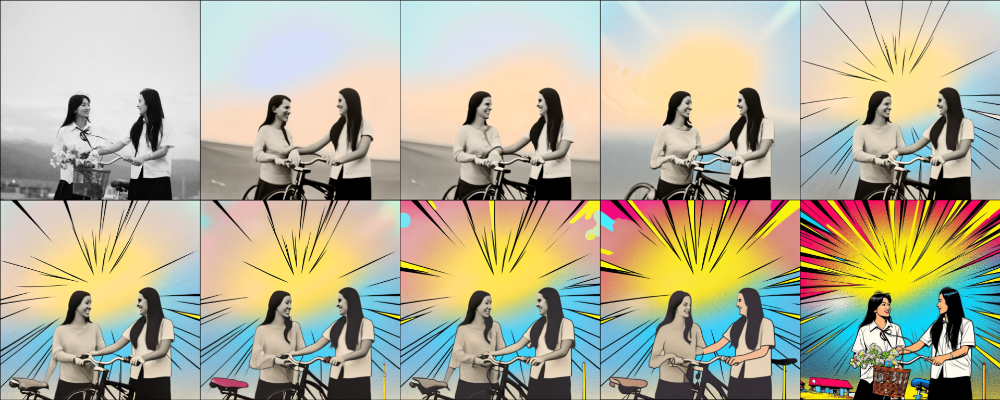
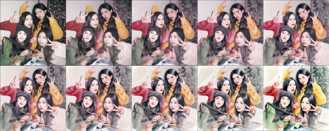

# StyleJudge

**A Human-Validated, In-Context-Learning Vision-Language Evaluator for Artistic Style Transfer**

*ICVGIP 2026*

[](https://huggingface.co/GamerQuant/Qwen3.5_0.8b_10kbalanced_k2_lora16)
[](LICENSE)
[](benchmark/README.md)

StyleJudge scores a stylized image the way a human rater does: it first looks at a few reference
source→stylized pairs that define the target style, then judges the query pair against them.
Existing metrics (Gram-matrix loss, LPIPS, CLIP image similarity) score a pair in isolation and correlate poorly with human
judgment. StyleJudge is a 0.8B vision-language model distilled from a 72B teacher, and it is validated directly
against human ratings.

- **Reference-conditioned.** Two exemplar pairs (K = 2) turn evaluation into a visual analogy task.
- **Compact.** A Qwen3.5-0.8B + LoRA student that runs on a single 16 GB GPU (NVIDIA T4); teacher is Qwen2.5-VL-72B.
- **Human-validated.** Released benchmark of 878 human ratings (728 seen-style pairs + 150 unseen-style pairs).
- **Reusable.** Score any future metric on the same pairs with [`benchmark/score_metric.py`](benchmark/score_metric.py).

## Results at a glance

Pearson / Spearman correlation with human ratings on the 728-pair benchmark (10 seen styles):

| Metric | Pearson r | Spearman ρ |
|---|---:|---:|
| Gram-matrix style loss (negated) | 0.041 | 0.049 |
| LPIPS (negated) | −0.404 | −0.394 |
| CLIP image similarity | 0.168 | 0.178 |
| Untuned base (0.8B, zero-shot)* | 0.019 | 0.017 |
| **StyleJudge (0.8B student)** | **0.291** | **0.325** |
| StyleJudge teacher (72B) | 0.327 | 0.337 |

\* Scored on the 711 of 728 pairs for which it returned a parseable score.

The untuned base model is uncorrelated with human ratings zero-shot (r = 0.019 on the 711 pairs it scores), so the
gain comes from fine-tuning.

On the 150 human-rated unseen-style rows (Acrylic, Pop Art) the student reaches r = 0.381 (teacher 0.408).
On 800 samples from the two validation styles (expressive, mosaic), held out from training, student–teacher
exact-match accuracy rises from 1.1% (untuned base) to 28.2%, with 67.8% shorter reasoning traces. Details,
confidence intervals and caveats are in [Results](#results).

## Quick start

```bash
cd inference
pip install -r requirements.txt
python infer_single.py --style acrylic \
    --ex_a_src ex1_src.png --ex_a_dst ex1_dst.png \
    --ex_b_src ex2_src.png --ex_b_dst ex2_dst.png \
    --q_src query_src.png  --q_res query_result.png
```

The adapter is downloaded from Hugging Face automatically. Batch evaluation is described in
[`inference/README.md`](inference/README.md). To score your own metric against the human ratings:

```bash
python benchmark/score_metric.py my_predictions.csv     # columns: row_id, score
```

On a single NVIDIA T4, StyleJudge scores a pair in 39 s (median over 900 pairs: the 878 rated pairs plus 22 unrated
ones) with 2.5 GB of peak GPU memory.

## Method

**How it differs from conventional metrics.**

| Feature | Traditional metrics (zero-shot) | StyleJudge (ICL-VLM) |
|---|---|---|
| Input modality | Isolated image pairs. | Multimodal context: reference pairs + query pair + text rubric. |
| Reasoning | Fixed feature similarity (DINO, CLIP, Gram). | Dynamic joint attention over visual tokens + language embeddings. |
| Output | Single uncalibrated scalar. | Three-metric scores + textual justification. |
| Style adaptability | Static, treats all styles identically. | Context-adaptive, calibrates to reference examples. |
| Score granularity | Continuous real-valued. | Discrete 1–10 integers, interpretable by humans. |
| Human-correlation validated | Not evaluated on our benchmark prior to this work. | Yes, see [Results](#results) (N = 728). |

**Evaluation protocol.** Each instance has K = 2 exemplar pairs (source → "perfect" stylized), a query pair, and
the style's text markers ([`docs/style_definitions.md`](docs/style_definitions.md)). The model returns three
1–10 scores in a structured XML block: Style Fidelity (SF), Content Preservation (CP) and Rendering Quality (RQ),
preceded by a three-step reasoning trace (style extraction, analogy check, conflict check). The full prompt is in
[`docs/icl_prompt.md`](docs/icl_prompt.md). The composite score is

```
S_final = min(RQ, CP)   if RQ ≤ 3 or CP ≤ 3
          SF            otherwise
```

When rendering or content is badly broken, the style cannot be compared at all, so the score is clamped to the more
severe failure; otherwise it reduces to style fidelity.

**Pipeline.**

1. **Pairs.** Source images from seven public collections are stylized with FLUX.1-dev Kontext and 12 style LoRAs.
2. **Graded supervision.** An SDXL-adapted FreeMorph adds 8 intermediate frames per pair, so the evaluator sees
   partial as well as complete stylization.
3. **Teacher labels.** Qwen2.5-VL-72B labels every item (2 exemplar pairs + style markers + query) with scores and a rationale.
4. **Failure-mode supervision.** Deliberately degraded morph sequences (raised guidance, quality-penalising
   negative prompt, near-zero frequency-filter thresholds, Gaussian latent noise; notebook 03) let the evaluator
   and raters see rendering and content failures.
5. **Distillation.** Qwen3.5-0.8B is LoRA-fine-tuned on those rationales with a score-digit-weighted loss (λ = 5).
6. **Inference.** Two exemplar pairs + a query give SF, CP, RQ and S_final.

**FreeMorph: SD 2.1 → SDXL.** The original SD 2.1 pipeline drifts in structure and identity between frames.
The SDXL port (768 → 1024 px, edit strength 0.8 → 0.6, CFG 7.5 → 6.5, 50 steps; latents slerp, embeddings lerp,
dual CLIP-G + CLIP-L conditioning) keeps content stable. Settings and more frames: [`docs/freemorph_sdxl.md`](docs/freemorph_sdxl.md).

**Example 1**




*SD 2.1 FreeMorph example (top) and SDXL-adapted example (bottom); the rows show different input pairs.*

**Example 2**




*SD 2.1 FreeMorph example (top) and SDXL-adapted example (bottom); the rows show different input pairs.*

## Training

Teacher–student distillation, Qwen2.5-VL-72B → Qwen3.5-0.8B (Unsloth `FastVisionModel`), single-epoch SFT:

| | |
|---|---|
| LoRA | r = 16, α = 32, dropout 0.05, rsLoRA disabled, all attention + MLP projections, vision + language layers |
| Sequence length | 8,192 tokens |
| Batch | 4 per device × 4 gradient accumulation = 16 |
| Optimizer | Paged AdamW 8-bit, lr 2×10⁻⁴, cosine schedule, 10 warmup steps, bf16 |
| Score-weighted loss | λ = 5.0 on score-digit tokens (Eq. 2) |
| Splits | 5,614 train (8 styles) / 1,326 val (2 styles) / 800 test (unseen: Acrylic, Pop Art) |

Images are loaded at 1024 px and resized to 512 px by Unsloth's vision pipeline.

Full tables: [`docs/training_hyperparameters.md`](docs/training_hyperparameters.md).


## Results

Reproduce: `python benchmark/reproduce_paper_numbers.py`

### Correlation with human judgment

Table above, plus:

- **Uncertainty.** Bootstrap 95% CI (N = 728): student r ∈ [0.225, 0.351], teacher r ∈ [0.258, 0.389];
  difference ∈ [−0.112, 0.037], so no significant student–teacher difference is detected. Per-rater student r:
  0.333 / 0.124 / 0.109 (n = 419 / 232 / 77).
- **Unseen styles.** 150 rows (Acrylic, Pop Art; exemplars and style markers still given): student r = 0.381
  (95% CI [0.24, 0.51]), teacher 0.408. All 878 rows: student 0.297, teacher 0.341.
- **Per style.** Both models have positive point estimates in all 12 styles (the 95% intervals for mosaic, and for the
  teacher on minimalist, include zero); the student exceeds the teacher
  in 10. After removing per-style means, the student's correlation on the 728 pairs is 0.368 (teacher 0.333); most
  of its remaining error is style-level calibration: the student gives a 9 to 39% of pairs and 1–3 to 43%, and uses
  the middle of the scale (4–6) for only 7%, whereas 33% of human ratings fall there.
- **Human agreement.** The separate 2-rater project-team pilot gives r = 0.25 (n = 50, p = 0.08, Fisher 95% CI [−0.03, 0.49], which
  includes zero). It is a reference point, not a ceiling or a same-set comparison, because the 728 benchmark rows are
  single-rated. We do not claim human parity.
- **Traditional metrics.** Gram is the mean squared difference between Gram matrices of ImageNet-pretrained VGG16
  features (layers 3, 8, 15, 22) of the query result and exemplar A's stylized image. LPIPS (VGG) is computed between
  the query source and its result. CLIP image similarity is the cosine similarity of CLIP ViT-B/32 image embeddings
  of the query result and exemplar A's stylized image. Images are resized to 256×256 (Lanczos). Gram and LPIPS are
  negated; all three are min-max scaled to 1–10 over the benchmark pairs and rounded.
- **Baseline interpretation.** LPIPS (source vs. result) is negatively correlated: its distance grows with stylization
  strength along the morph strips (Spearman rho = 0.66 with frame index), which raters reward. Gram-matrix loss is
  essentially uncorrelated (r = 0.041). An unsigned stylization-strength proxy such as raw LPIPS distance (r = 0.405)
  is therefore a strong baseline on this benchmark, because most queries come from graded morph strips.

More in [`docs/human_study_results.md`](docs/human_study_results.md).

### Teacher imitation (800 validation-style samples)

Exact match of S_final against the Qwen2.5-VL-72B teacher on 800 samples from the two validation styles
(expressive, mosaic), held out from training. This is an internal-consistency check; agreement with the teacher
does not by itself establish alignment with human judgment.

| Model | Exact | Within ±1 | MAE | Avg. output (chars) |
|---|---:|---:|---:|---:|
| Qwen3.5-0.8B, untuned | 1.1% | 12.4% | 5.179 | 8,088 |
| Qwen3.5-0.8B + SFT (ours) | **28.2%** | **54.4%** | **2.109** | 2,606 |

### Ablations

| K (exemplars) | MAE ↓ | Exact (%) | ±1 (%) | Avg. length (chars) |
|---|---:|---:|---:|---:|
| 0 | 5.179 | 1.1 | 12.4 | 8,088 |
| 1 | 2.842 | 22.8 | 43.1 | 2,689 |
| **2** | **2.109** | **28.2** | **54.4** | 2,606 |
| 3 | 2.600 | 19.6 | 44.0 | 3,527 |

The K sweep uses the same 800 validation-style items (expressive, mosaic) for every K, all scored against the
teacher's labels in the K=3 annotation set; the K=3 adapter was trained on 3,860 examples.

K = 0 is the untuned base model; each K ≥ 1 row uses its own adapter, trained and evaluated with that K (see the
training-loss figure). The K = 0 → 1 jump therefore includes fine-tuning; K = 3 < K = 2: with 512-px images a
third exemplar pair adds only several hundred tokens, so the 8,192-token budget is unlikely to be the main cause;
the K=3 adapter was trained on fewer examples (3,860 vs. 5,614) and writes longer outputs, so the sweep does not
isolate K alone.
The λ sweep covered {1, 2, 3, 4, 5} and selected the boundary value 5.

### Zero-shot pilot

88 pairs scored by Qwen2.5-VL-7B (ImgEdit-Judge weights); 50 had paired annotations from two raters.
VLM–human Pearson r = 0.19 (p = 0.18), Spearman ρ = 0.11; the VLM under-estimated in 62% of cases (31/50).

### Limitations

- The student's raw RQ/CP reach the clamp regime in only 4 of 26 teacher-flagged clamp cases, so its final score often
  matches the teacher without recognizing the failure.
- Attention rollout is illustrative, not causal evidence ([`docs/attention_rollout.md`](docs/attention_rollout.md)).
- All training data come from one generator family (FLUX.1 Kontext LoRAs); cross-generator transfer is untested.
- The clamp threshold and λ were set heuristically; λ was swept only over 1–5, without an unweighted (λ = 0) run.
- ArtFID (set-level) and HPSv2 (text-to-image preference) give no per-pair exemplar-conditioned score; CSD was not run.
- Benchmark items were sampled with roughly uniform teacher scores, which widens the quality range compared with
  a natural sample and may favour the teacher.

## Human-rated benchmark

878 human ratings from three project-team members who served as raters. They have no formal art training and each
worked alone on a separate part of the data; pairs were single-rated. The ratings cover 728 seen-style benchmark pairs
(10 styles) and 150 unseen-style pairs (Acrylic, Pop Art; 75 each). [`benchmark/`](benchmark/) contains the ratings,
a manifest mapping every `Row_ID` to its image paths, style, split and benchmark flag, and the scoring script.
Protocol and verbatim guideline: [`docs/annotation_protocol.md`](docs/annotation_protocol.md).

## Data

Source images (1024×1024, square, Lanczos-resampled) come from the public collections listed below. The curated
source-image pool is not released.

| Source | Contribution |
|---|---|
| [HQ-50K](https://github.com/littleyaang/hq-50k) | Indoor, outdoor, artificial-domain coverage |
| [LAION-2B squarish 1024px](https://huggingface.co/datasets/opendiffusionai/laion2b-squareish-1024px) | Large-scale general pool |
| [OmniConsistency](https://github.com/showlab/OmniConsistency) | Non-photorealistic: 3D, Chibi, illustration |
| [Pexels](https://www.pexels.com) | Macro photography |
| iNaturalist ([fish](https://www.kaggle.com/datasets/chandavandann/global-fish-species-image-dataset-inaturalist), [birds](https://www.kaggle.com/datasets/sharansmenon/inat2021birds), [insects](https://www.kaggle.com/datasets/yoanndev90/inaturalist-insects)) | Macro subjects: insects, birds, fish, botanicals |
| [LHQ-1024](https://www.kaggle.com/datasets/dimensi0n/lhq-1024) | Landscape scenes |
| [Unsplash](https://unsplash.com) | Landscape scenes, atmospheric variation |

Generated and derived datasets (Google Drive folder with generated and derived assets: [Datasets](https://drive.google.com/drive/folders/1hzk80mSjpXRNwI5kUuDLyTcYRblOymeB)):

| Dataset | Description | Source |
|---|---|---|
| Style Rationale (110, 117) | Teacher XML rationales, batches 1 and 2 | [Kaggle](https://www.kaggle.com/datasets/yatishjuneja/style-rationale-final) |
| Extracted Morph Strips, Part 1 / Part 2 | FreeMorph-SDXL frames, styles 1–6 / 7–12 | [Part 1](https://www.kaggle.com/datasets/somanshu7527/extracted-strips-part-1), [Part 2](https://www.kaggle.com/datasets/somanshu7527/extracted-strips-part-2) |
| ImgEdit-Dev-700 | Pilot style-transfer pairs | [Hugging Face](https://huggingface.co/datasets/sysuyy/ImgEdit) |
| Human ratings | Released ratings and manifest | [`benchmark/`](benchmark/) |
| input_dataset | Benchmark images referenced by `benchmark/manifest.csv` | [Kaggle](https://www.kaggle.com/datasets/sachitbansal2006/input-dataset) |

Images are not stored in this repository. Check each source's license before redistributing.
More: [`docs/dataset_sources.md`](docs/dataset_sources.md), [`docs/dataset_generation.md`](docs/dataset_generation.md).

## Repository structure

```
StyleJudge/
├── README.md
├── LICENSE                 # Apache-2.0 (code)
├── inference/              # run the 0.8B student (adapter on Hugging Face)
├── benchmark/              # human ratings, manifest, scoring scripts (CC BY 4.0)
├── notebooks/              # data generation, teacher labelling, SFT, evaluation (Kaggle)
│   └── future_work/        # exploratory GRPO notebook
├── docs/                   # supplementary material as browsable pages
└── assets/figures/         # figures used in the README and docs
```

Notebook order and descriptions: [`notebooks/README.md`](notebooks/README.md). References: [`docs/references.md`](docs/references.md).

## Future work

- **GRPO / reward signal.** StyleJudge could serve as a reward signal for training stylization models (e.g. with Group
  Relative Policy Optimization). An exploratory notebook is in
  [`notebooks/future_work/`](notebooks/future_work/); none of this is part of the reported results.
- Longer SFT, larger-scale human preference data, and broader baselines (DINO, PickScore, CSD, ArtFID) scored on the released benchmark.

## License

Code: Apache-2.0 ([`LICENSE`](LICENSE)). Human ratings and manifest: CC BY 4.0.

If you use this work, please cite our ICVGIP 2026 paper; GitHub's 'Cite this repository' button (from CITATION.cff) gives the BibTeX.
