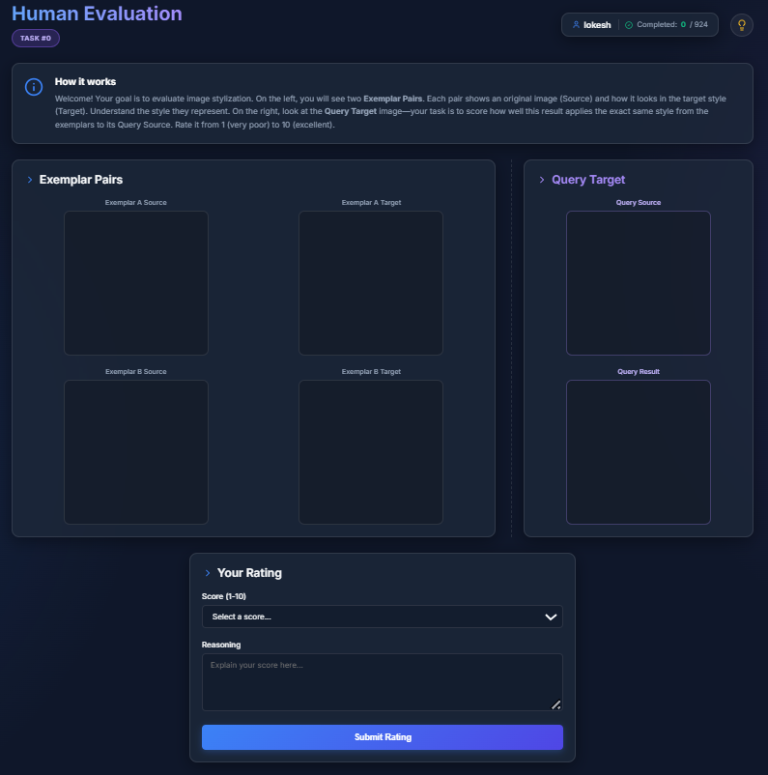

# Human annotation protocol

This document describes the human annotation study used for the image-stylization evaluation in the paper:
rater methodology, the briefing and guideline shown to raters, the annotation interface, and the released
rating files.

## 1. Rater methodology

Three project-team members served as raters; none had formal art training. Each worked alone on a separate part
of the data, and each dataset pair was **single-rated** (one rater per pair). This differs from the 2-rater paired
pilot described in §4.1 of the main paper.

Raters are identified by code in the released files (`R-J`, `R-A`, `R-S`).

| Rater | Rows | Share |
|---|---:|---:|
| R-J | 502 | 57.18% |
| R-A | 276 | 31.44% |
| R-S | 100 | 11.39% |
| **Total** | **878** | 100% |

882 ratings were collected; 4 empty rows were dropped, leaving the 878 released rows. Of these, **728** are
seen-style items (10 styles) that form the benchmark used for the correlation analysis, and **150** are
Acrylic / Pop Art items (unseen styles, 75 each). See [`human_study_results.md`](human_study_results.md).

## 2. What raters were given

Raters went through three stages:

1. **Briefing (before annotation).** Definitions and example images for each style. The definitions are the
   style-marker strings in [`style_definitions.md`](style_definitions.md); the example images are the
   source→stylized pairs of Figure 1 of the main paper.
2. **Guideline (before annotation).** The scoring text in §3, shown verbatim.
3. **Interface (during annotation).** Two exemplar pairs, the query pair, a 1–10 score selector and a short
   reasoning field (§4). The definitions were not repeated on screen.

## 3. Rating guideline (verbatim, as shown to raters)

> **Score assignment:**
> If rendering or content preservation is very poor (for example, you cannot discriminate the style transfer or
> the output is severely degraded), give a score between 1–3.
> If rendering and content preservation are almost good, then decide the score solely on the basis of style
> fidelity (i.e., how well the output matches the target style), using the most intuitive judgement possible.
> Provide a short reasoning statement explaining the logic behind your score.

## 4. Annotation interface

Raters used a web-based interface that showed: (i) two exemplar pairs, each a source image and its
stylized/target image; (ii) a query source image and its stylized/result image; (iii) controls for selecting a
numeric score (1–10) and a free-text field for short reasoning; and (iv) a progress indicator.

*Annotation interface as shown to raters: the two exemplar pairs, the query candidate, the score selector and
the free-text rationale field.*

## 5. Released files

| File | Description |
|---|---|
| [`benchmark/human_ratings.csv`](../benchmark/human_ratings.csv) | The 878 human ratings |
| [`benchmark/manifest.csv`](../benchmark/manifest.csv) | Per-row image paths, style, split, benchmark flag |

`human_ratings.csv` columns: `Row_ID` (UUID, unique), `Row_Index` (index within the rater's view of the dataset;
not unique across raters), `Style` (target style label), `Username` (rater code), `Score` (1–10), `Reasoning`
(short free text), `Timestamp` (ISO 8601). Join to the manifest on `Row_ID` (`row_id` in the manifest).
See [`benchmark/README.md`](../benchmark/README.md).
