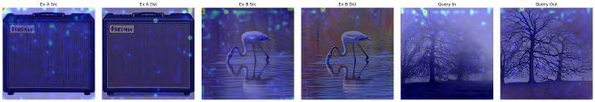
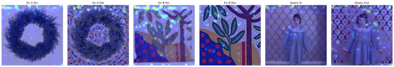

# Additional attention-rollout examples

Extends Figure 2 of the main paper (a single mosaic query) with further styles and exemplar-pair combinations.
In each strip: Exemplar A source/target, Exemplar B source/target, Query Input, Query Output.

*Attention rollout for a query evaluated against two exemplar pairs (Ex A, Ex B), shown alongside the Query
Input and Query Output. Attention concentrates on prompt-relevant regions of both the exemplar and query images.*

*Attention rollout for a mosaic-style query. Attention concentrates on tile-and-grout structure in the exemplar
targets and on the corresponding regions of the query output.*

Attention rollout is illustrative, not causal evidence. The maps also show low-intensity background attention
consistent with ViT "attention sink" artefacts, and we make no claim that the 0.8B model robustly attends to
brushstroke or colour-gamut cues over high-frequency noise.
