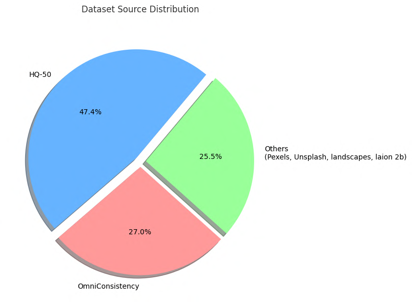

# Dataset sources and splits

## Source collections

Source images were aggregated from seven collections (Table 4 of the paper), listed below. Only square images were kept and
all were standardised to 1024×1024 px with Lanczos resampling (HQ-50K: sides in [800, 1024) px are upscaled;
other sources: [1000, 1024) px; larger images are downscaled; smaller ones are discarded), giving a curated
pool of about 10K images.

| Source | Contribution |
|---|---|
| [HQ-50K](https://github.com/littleyaang/hq-50k) | Indoor, outdoor, artificial-domain coverage |
| [LAION-2B squarish 1024px](https://huggingface.co/datasets/opendiffusionai/laion2b-squareish-1024px) | Large-scale general 1024×1024 pool |
| [OmniConsistency](https://github.com/showlab/OmniConsistency) | Non-photorealistic: 3D, Chibi, illustration |
| [Pexels](https://www.pexels.com) | Macro photography |
| iNaturalist ([fish](https://www.kaggle.com/datasets/chandavandann/global-fish-species-image-dataset-inaturalist), [birds](https://www.kaggle.com/datasets/sharansmenon/inat2021birds), [insects](https://www.kaggle.com/datasets/yoanndev90/inaturalist-insects)) | Macro subjects: insects, birds, fish, botanicals |
| [LHQ-1024](https://www.kaggle.com/datasets/dimensi0n/lhq-1024) | Landscape scenes |
| [Unsplash](https://unsplash.com) | Landscape scenes, atmospheric variation |

Images are not re-hosted in this repository; check each source's
license before redistributing.

*HQ-50K contributes the largest share of the curated pool (47.4%), followed by OmniConsistency (27.0%) and
the remaining sources combined (Pexels, Unsplash, landscape collections, LAION-2B; 25.5%).*

## Teacher-rationale splits

| Split | Samples | Styles | Note |
|---|---:|---:|---|
| Train | 5,614 | 8 | Qwen2.5-VL-72B rationales |
| Val | 1,326 | 2 | Held out from the seen styles |
| Test | 800 | 2 | Unseen: Acrylic, Pop Art |

## Human-rated benchmark

Separate from the splits above; see [`human_study_results.md`](human_study_results.md) and
[`../benchmark/README.md`](../benchmark/README.md). The 728-pair benchmark covers the 10 seen styles
(the 8 training and 2 validation styles). The 150 Acrylic / Pop Art rows are rated separately.
