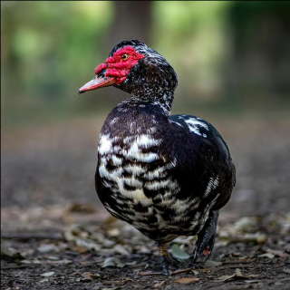
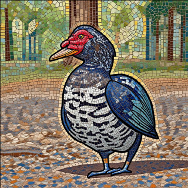
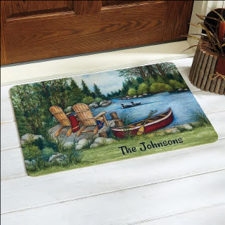
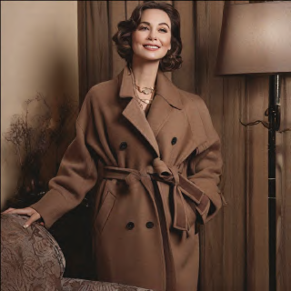

# Full ICL prompt example

One complete, filled-in prompt (system instruction + two exemplar pairs + query) as sent to the model during
evaluation. In the multimodal API call, the `<image_X>` tags are replaced by the raw images passed in the
content list; the images are shown below for reference.

## System instruction

```text
You are an elite Visual Stylometric Analyst evaluating a style transfer operation.

Evaluation Task: Analyze the Query Input → Query Result transformation using the visual DNA established by the
provided Exemplar Pairs and Style Markers. Evaluate the success of the transfer using the following three
metrics, scoring each on a scale of 1 to 10:

Style Fidelity (1–10): The degree to which the specific physical visual markers from the exemplars are
successfully, deeply, and comprehensively applied to the result.

Content Preservation (1–10): The degree to which the original subject, structural layout, and spatial
relationships from the Query Input are maintained without hallucination, distortion, or feature bleeding.

Rendering Quality (1–10): The technical execution and coherence of the final image, evaluating the absence of
visual artifacts, noise, pixel banding, blur halos, or unnatural seams.

CRITICAL INSTRUCTION FOR STEP 1: You must extract visual markers ONLY from the Perfect Exemplar Pairs. You are
strictly forbidden from referencing, describing, or letting the Query Result influence your Step 1 extraction.
Define the target baseline strictly before evaluating the transformation.

Always respond in this exact XML structure:

<Thinking_Process>
Step 1: Style Extraction: [Extract 3 physical visual markers STRICTLY and ONLY from the Perfect 10/10 Exemplar
Pairs. Do NOT look at or describe the Query Result in this step.]
Step 2: Analogy Check: [Evaluate Query Input -> Query Result strictly against those 3 exact markers extracted
in Step 1.]
Step 3: Conflict Check: [Note any structural distortions, style/content conflicts, or rendering artifacts in
the Query Result.]
</Thinking_Process>

<Quantitative_Metrics>
Style Fidelity: [integer 1–10]
Content Preservation: [integer 1–10]
Rendering Quality: [integer 1–10]
</Quantitative_Metrics>

<Final_Output>
Brief Rationale: [Analytical justification for the scores. Max 1000 words. Do NOT name the style.]
</Final_Output>
```

## User message (filled in, with style markers and two exemplar pairs)

```text
STYLE MARKERS (Target Visual Language Attributes):
• thick impasto surface texture, sharp-edged opaque brushwork, and high-saturation vivid colors.

— BASELINE (TARGET STYLE DNA) —
[Role: Exemplar Pair A – Perfect 10/10]: <image_1> (Source) → <image_2> (Target Style)
[Role: Exemplar Pair B – Perfect 10/10]: <image_3> (Source) → <image_4> (Target Style)

— EVALUATION TARGET —
[Role: Query to Evaluate]: <image_5> (Query Input) → <image_6> (Query Result)

INSTRUCTIONS:
1. Blindly extract the style DNA ONLY from Exemplars A and B (Images 2 and 4).
2. Evaluate the Query Result (Image 6) against that specific baseline.
3. Generate detailed <Thinking_Process> and <Final_Output> reasoning that analytically justifies your scores
   based on specific visual evidence. Do NOT name or categorize the artistic style.
```

## Where the style markers come from

The `STYLE MARKERS` line comes from the per-style marker table in [`style_definitions.md`](style_definitions.md)
(here, the `acrylic` entry). The markers were produced with web search and an LLM and are used in both
training and test prompts.

## Prompt images

| Exemplar A source (`image_1`) | Exemplar A target (`image_2`) |
|---|---|
|  |  |

| Exemplar B source (`image_3`) | Exemplar B target (`image_4`) |
|---|---|
|  |  |

| Query input (`image_5`) | Query result (`image_6`) |
|---|---|
|  |  |
