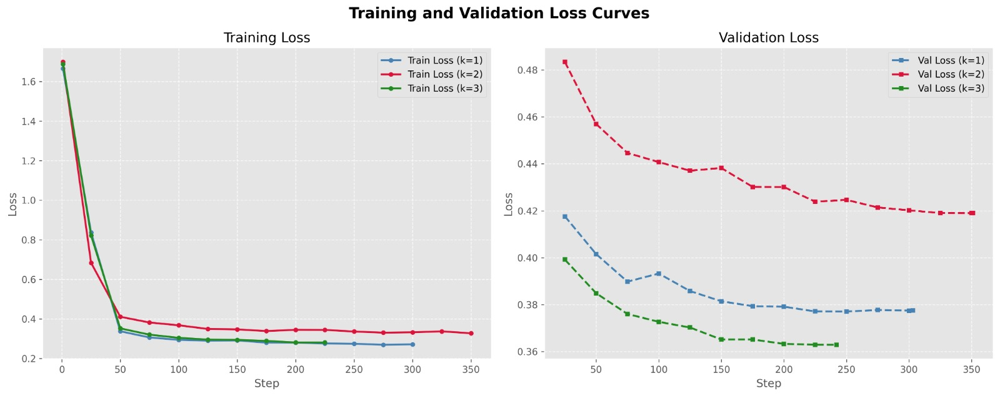

# Training hyperparameters

LoRA fine-tuning and SFT configuration used to train the 0.8B student (Qwen3.5-0.8B) from the
Qwen2.5-VL-72B teacher rationales (§3.3 of the paper).

## LoRA configuration

| Hyperparameter | Value | Description |
|---|---|---|
| LoRA rank (r) | 16 | Dimensionality of the update matrices |
| LoRA alpha | 32 | Scaling factor for the LoRA updates |
| LoRA dropout | 0.05 | Dropout inside the LoRA layers |
| Target modules | `q_proj`, `k_proj`, `v_proj`, `o_proj`, `gate_proj`, `up_proj`, `down_proj` | Linear layers receiving low-rank updates |
| Bias | None | Bias parameters are not trained |
| rsLoRA | Disabled | Rank-stabilized LoRA is not used |
| Trainable modules | Vision layers, language layers, attention, MLP | Unsloth overrides enabling gradients across visual and textual features |

## SFT configuration

| Hyperparameter | Value | Description |
|---|---|---|
| Max sequence length | 8192 | Context window (tokens) for SFT |
| Epochs | 1 | Passes over the dataset |
| Batch size per device | 4 | Samples per GPU per step |
| Gradient accumulation steps | 4 | Effective batch size 16 |
| Learning rate | 2 × 10⁻⁴ | Peak learning rate |
| LR scheduler | Cosine | Cosine decay |
| Warmup steps | 10 | Linear warmup |
| Optimizer | Paged AdamW 8-bit | Memory-efficient optimizer |
| Precision | bfloat16 | Mixed precision |
| Image size | 1024 | Resolution limit (constrains visual token count) |
| Custom loss (score weight λ) | 5.0 | Extra weight on score-digit tokens (Eq. 2 of the paper); swept over λ ∈ {1, 2, 3, 4, 5} |
| Evaluation steps | 25 | Validation frequency |
| Save steps | 100 | Checkpoint frequency |
| Random seed | 42 | Shuffling and initialization |

The λ sweep stopped at 5 (the boundary value was selected).

The K sweep is evaluated on the same 800 validation-style items (expressive, mosaic) for every K, drawn from the
K=3 annotation set; the K=3 adapter was trained on 3,860 examples.
